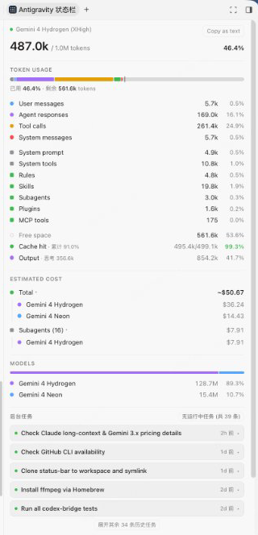

# Antigravity Status Bar (antigravity-status-bar)

[简体中文](README.md) | **English**

A live side-panel status bar plugin for the **Antigravity 2.0 desktop app** — reads the conversation's local SQLite + Protobuf database read-only with **0 tokens consumed per refresh**.



## Features

- **Claude Code Style Segmented Context Bar**: Color-coded proportional bar (`System / User / Agent / Tools / Custom / SysMsg`) with a **request-budget / compaction threshold tick mark**; hover any segment to inspect token counts and highlight matching breakdown rows.
- **Unified Token Usage (Cache Hit & Output Stats)**: Shows per-category token usage alongside compact inline rows for `Cache hit` (latest turn + session cumulative hit rate) and `Output` (total output + thinking token share).
- **Per-Model Usage Breakdown (`Models`)**: Built for Orchestrator / multi-model sessions — summarizes call counts, cumulative token share, and cache hit rate per model (automatically hidden in single-model conversations).
- **Background Tasks & Subagents Monitor**: Captures active and recent `run_command` jobs, `Daemon` processes, `Timer` schedules, and `Subagent` invocations; click any item to inspect the command/prompt (clipped above 32K chars), status, and live log tail (last 32 KB).
- **Zero Token Cost & Native Theming**: Polls locally every 3 seconds via Antigravity Sidecar, syncs live context limits from the app's model catalog, and adapts automatically to light/dark themes.

## Quick Install

### Option 1: Copy & Paste Prompt to Your Agent (Recommended)

Send this prompt directly to Antigravity (requires `git` and `Python 3.9+` installed):

```text
Please install the "Antigravity 状态栏" (antigravity-status-bar) plugin for me:
1. Clone https://github.com/ballShell/antigravity-status-bar.git into ~/.gemini/config/plugins/antigravity-status-bar (or pull the latest changes if it already exists).
2. Verify the plugin layout is intact, then remind me to enable "Antigravity 状态栏" under Customizations → Installed and open it from the right-side panel.
```

### Option 2: Manual One-Line Install

**macOS / Linux:**

```bash
git clone https://github.com/ballShell/antigravity-status-bar.git ~/.gemini/config/plugins/antigravity-status-bar
```

**Windows (PowerShell):**

```powershell
git clone https://github.com/ballShell/antigravity-status-bar.git "$HOME\.gemini\config\plugins\antigravity-status-bar"
```

After cloning, restart Antigravity (or toggle **Antigravity 状态栏** on in **Customizations → Installed**) and open it from the `+` menu in the right-side auxiliary pane.

## Acknowledgements

Forked from [dimitr-io/antigravity-desktop-context](https://github.com/dimitr-io/antigravity-desktop-context). Special thanks to the original author for the SQLite/Protobuf trajectory parser, live model catalog integration, and Sidecar panel foundation.

Licensed under the [MIT](LICENSE) License.
