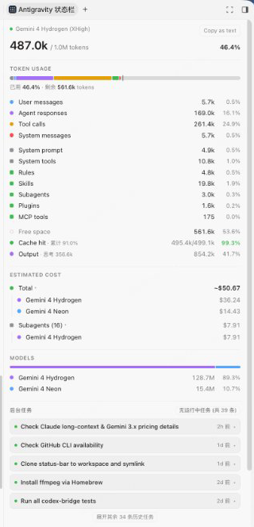

# Antigravity 状态栏（antigravity-status-bar）

**简体中文** | [English](README.en.md)

---

一款专为 **Antigravity 2.0 桌面端**打造的实时侧边状态栏插件——直接只读解析会话本地数据库（SQLite + Protobuf），**每次刷新消耗 0 Token**。



## 核心功能

- **Claude Code 风格分段上下文条**：按 `System / User / Agent / Tools / Custom / SysMsg` 分色展示上下文占用比例，内置**裁剪/压缩阈值刻度线**，悬停任一色段可实时查看数值并联动高亮明细行。
- **合并式 Token Usage（含缓存命中率 & 输出思考占比）**：汇总消息、系统提示词、工具、Rules、Skills、Subagents、Plugins、MCP 等各维度 Token；底部紧凑单行直接展示 `Cache hit`（单次 + 会话累计命中率）与 `Output`（累计输出 + 思考 Token 占比）。
- **多模型用量分布（Models）**：适配 Orchestrator 混用模型场景，自动统计当前会话各模型的调用次数、累计 Token 占比及分模型缓存命中率（单模型会话自动隐藏，保持界面克制）。
- **后台任务 & Subagent 实时监控**：自动捕捉当前会话的后台命令（`run_command`）、守护进程（`Daemon`）、定时器（`Timer`）及子 Agent（`Subagent`）；点击即可展开查看命令 / Prompt（超长时截断至 32K 字符）、执行状态与实时日志尾部（末尾 32 KB）。
- **零额外消耗 & 跨平台开箱即用**：通过 Antigravity Sidecar 每 3 秒只读轮询，模型上下文上限自动同步应用内实时目录，原生自适应明暗主题；深度兼容 **macOS / Linux / Windows 10 & 11**（自动跳过 Windows Store 占位符并从 `py`、官方安装目录、Conda/Miniconda、uv、Scoop 及 Windows 注册表发现 Python 3.9+，兼容 PowerShell UTF-16LE 与 CMD GB18030 日志编码）。

## 快捷安装

### 方式一：直接复制给 Agent 安装（推荐）

把下面这段提示词直接发给 Antigravity（需要本机已安装 `git` 与 `Python 3.9+`）：

```text
请帮我安装「Antigravity 状态栏」插件：
1. 将 https://github.com/ballShell/antigravity-status-bar.git 克隆到 ~/.gemini/config/plugins/antigravity-status-bar（若目录已存在则拉取最新代码）。
2. 完成后检查插件结构是否完整，并提醒我前往 Antigravity 的 Customizations → Installed 开启「Antigravity 状态栏」，然后在右侧面板打开使用。
```

### 方式二：手动一行命令安装

**macOS / Linux：**

```bash
git clone https://github.com/ballShell/antigravity-status-bar.git ~/.gemini/config/plugins/antigravity-status-bar
```

**Windows (PowerShell)：**

```powershell
git clone https://github.com/ballShell/antigravity-status-bar.git "$HOME\.gemini\config\plugins\antigravity-status-bar"
```

安装后重启 Antigravity（或进入 **Customizations → Installed** 开启 **Antigravity 状态栏**），即可在右侧辅助栏 `+` 菜单中打开。

## 致谢

本项目 Fork 自 [dimitr-io/antigravity-desktop-context](https://github.com/dimitr-io/antigravity-desktop-context)，由衷感谢原作者在 Antigravity 会话库 Protobuf 解析、实时模型目录同步与 Sidecar 面板架构上的扎实工作。

基于 [MIT](LICENSE) 协议开源。
